# Manual do Sistema SLM

Sistema de Serviços de Logística e Manutenção da JUCESP. Este manual explica, passo a passo, o que cada pessoa faz no sistema. As imagens usam **dados fictícios** de teste.

**Sumário**

1. [Entrar, criar conta e recuperar a senha](#1-entrar-criar-conta-e-recuperar-a-senha)
2. [Primeiros passos: início, painel, pesquisa e avisos](#2-primeiros-passos)
3. [Pedir serviços (solicitante)](#3-pedir-servicos-solicitante)
4. [Atender os pedidos (equipe SLM)](#4-atender-os-pedidos-equipe-slm)
5. [Almoxarifado](#5-almoxarifado)
6. [Controle de Demandas, atas e contratos](#6-controle-de-demandas-atas-e-contratos)
7. [Portal do Motorista](#7-portal-do-motorista)
8. [Administração](#8-administracao)
9. [Dúvidas frequentes](#9-duvidas-frequentes)

---

## 1. Entrar, criar conta e recuperar a senha

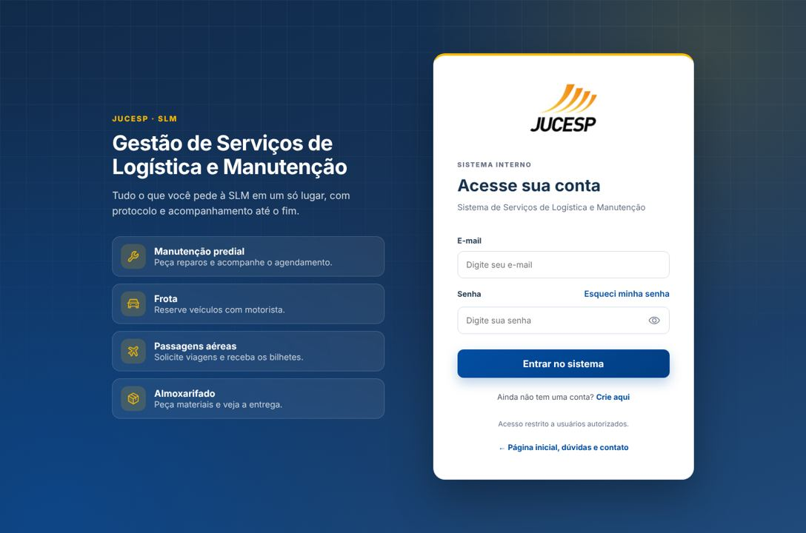

**Entrar**
1. Abra o endereço do sistema e clique em **Entrar**.
2. Digite o **e-mail institucional** e a **senha**.
3. Para conferir o que digitou, clique no **olho** dentro do campo de senha. Clique de novo para esconder.
4. Clique em **Entrar no sistema**.

**Criar conta**
1. Na tela de entrada, clique em **Crie aqui**.
2. Preencha nome, e-mail institucional, setor e uma senha com **12 caracteres ou mais**.
3. Clique em **Solicitar acesso**. A conta fica pendente até a equipe aprovar. Você recebe o acesso depois da aprovação.

**Esqueci minha senha**
1. Na tela de entrada, clique em **Esqueci minha senha**, ao lado do campo de senha.
2. Informe o e-mail cadastrado e clique em **Enviar código**.
3. Digite o código de 6 números recebido por e-mail e escolha a nova senha. O código vale por 10 minutos.

**Instalar no celular**
- **Android:** ao abrir o sistema pelo Chrome, toque em **Instalar** no convite, ou no menu ⋮ → **Instalar aplicativo**.
- **iPhone:** no Safari, toque em **Compartilhar** (o quadrado com a seta) → **Adicionar à Tela de Início**.

Instalado, o sistema abre direto da tela inicial do celular, como um aplicativo. Com sinal fraco, as telas abrem do mesmo jeito. Para enviar ou receber informações, ainda é preciso internet.

---

## 2. Primeiros passos

### Início

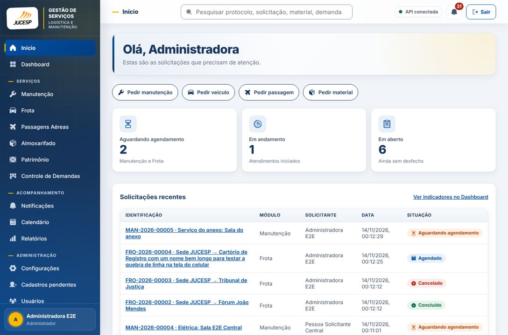

O menu da esquerda leva a cada módulo. No celular, ele abre pelo botão ☰ no topo. Você vê só os módulos que o seu perfil permite.

### Dashboard

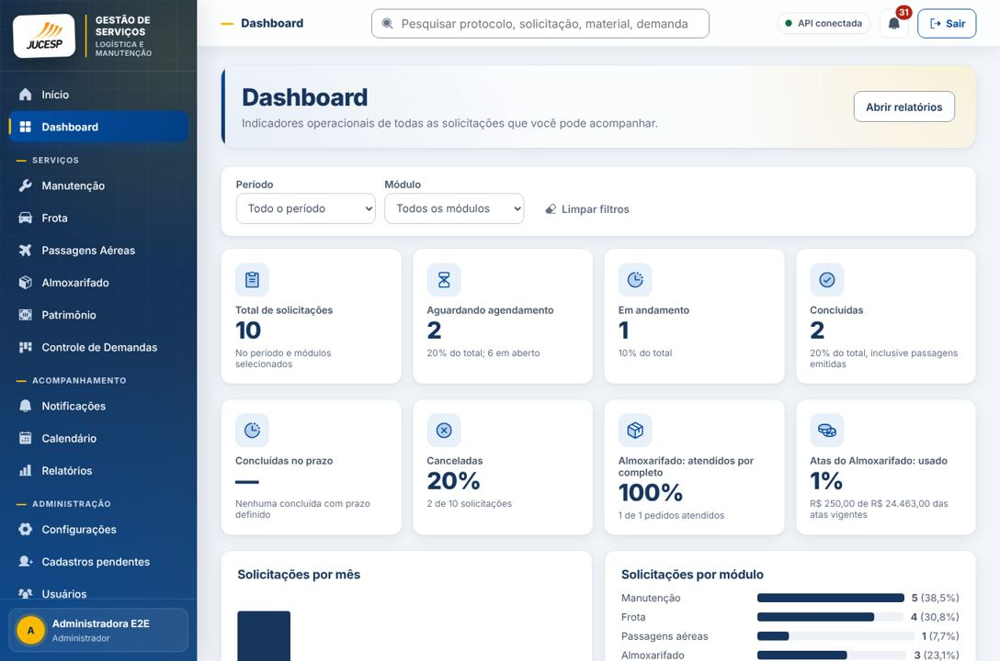

- Os cartões do alto mostram os totais do período e a comparação com o período anterior. A seta verde indica melhora.
- **Solicitações por mês** mostra uma linha para cada módulo. Passe o mouse sobre um mês para ver os números, ou clique em **Ver em tabela**.
- Os filtros do alto mudam o período e o módulo.

### Pesquisa

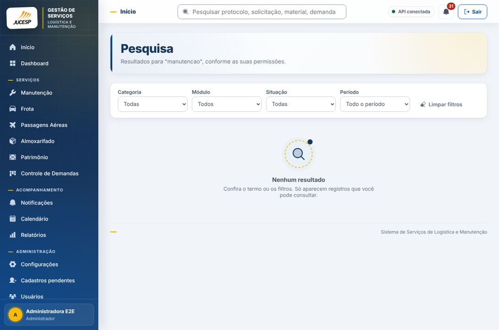

O campo **Pesquisar** no topo procura por protocolo, solicitação, material e demanda em todo o sistema. Digite ao menos 2 letras.

### Notificações

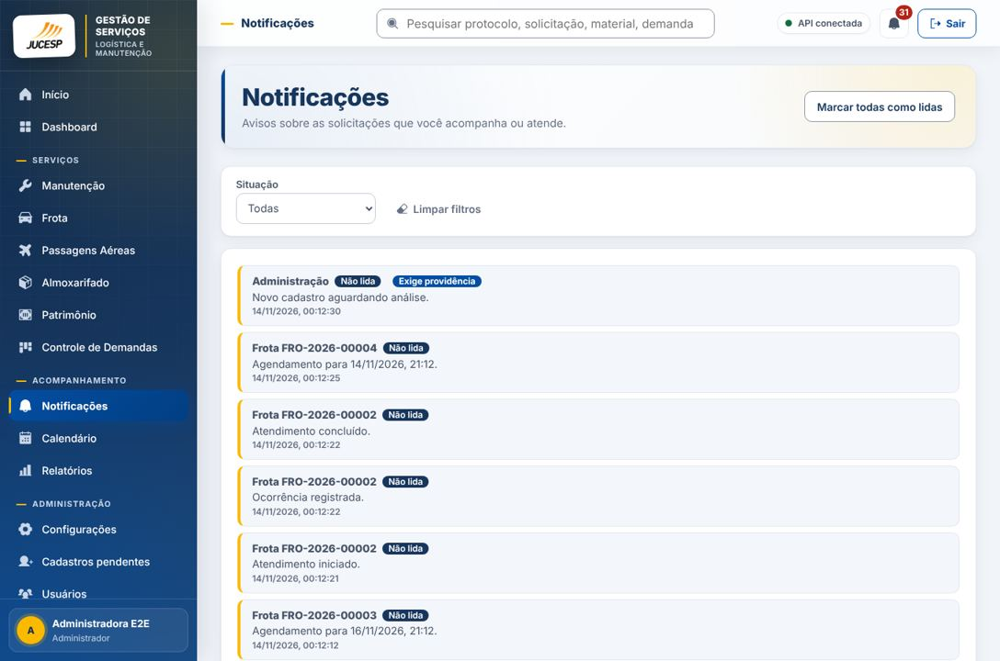

O sino no topo mostra os avisos novos, como agendamento, mudança de situação e prazos. Em **Notificações** fica o histórico completo.

### Tabelas

- **Ordenar:** clique no título de uma coluna. O primeiro clique ordena em ordem crescente, o segundo inverte e o terceiro volta à ordem original.
- **Cabeçalho fixo:** em listas longas, o cabeçalho fica visível enquanto você rola a tabela.
- **Carregando:** enquanto os dados chegam, aparecem blocos cinza no lugar do conteúdo.

---

## 3. Pedir serviços (solicitante)

### Manutenção predial

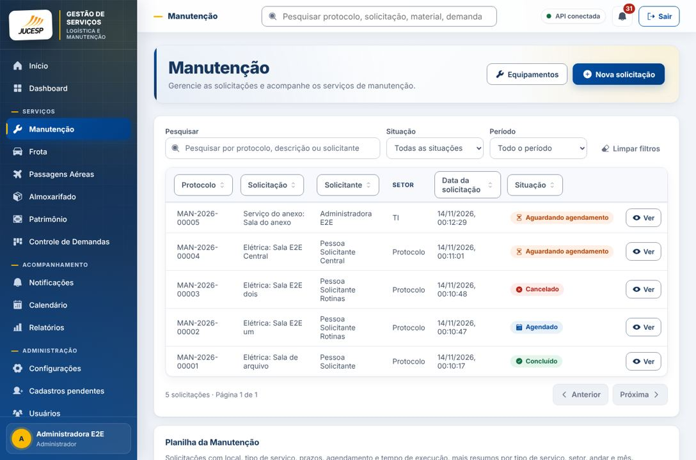

1. No menu, clique em **Manutenção** e depois em **Nova solicitação**.
2. Preencha andar, tipo de serviço, local e a descrição do problema. Os campos com * são obrigatórios.
3. Se o formulário tiver um campo de **arquivo**, como "Orçamento em arquivo", escolha o arquivo. Ele vai para **Documentos e anexos** da solicitação.
4. Clique em **Enviar solicitação**. A solicitação recebe um **protocolo** e aparece na lista.

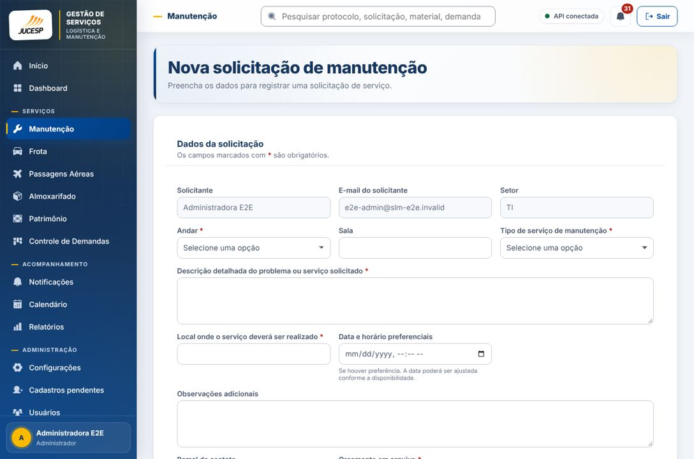

Para acompanhar, clique em **Ver** na lista. O detalhe mostra a situação, o agendamento, os anexos e a linha do tempo com tudo o que aconteceu.

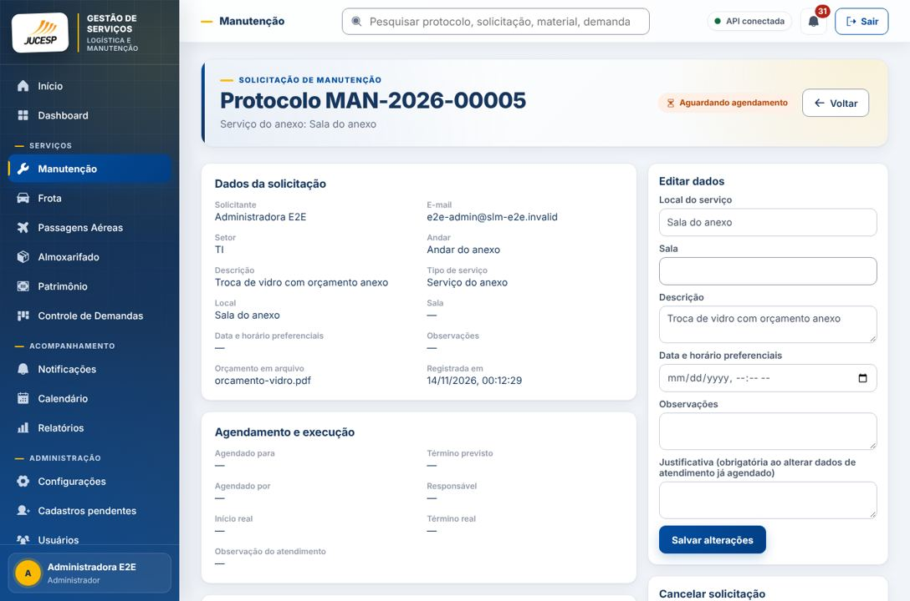

### Frota (veículo com motorista)

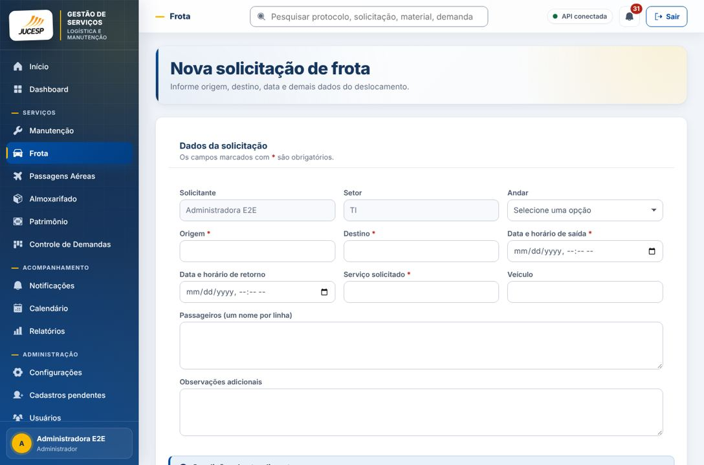

1. Clique em **Frota** e depois em **Nova solicitação**.
2. Informe o trajeto, a data e o horário de saída, o retorno previsto e os passageiros.
3. Clique em **Enviar solicitação**. A equipe da Frota agenda o veículo e o motorista, e você é avisado.

### Passagens aéreas

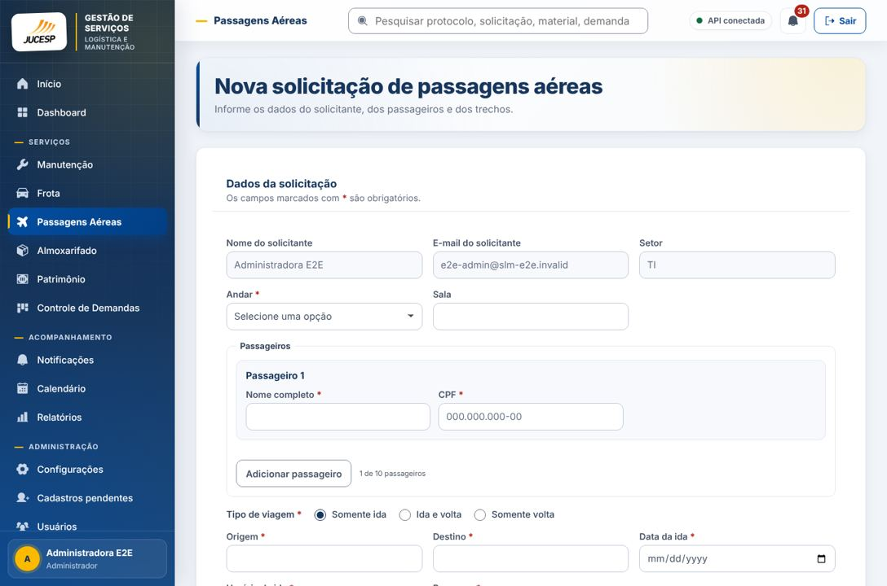

1. Clique em **Passagens Aéreas** e depois em **Nova solicitação**.
2. Escolha o tipo de viagem (ida e volta, só ida ou só volta), informe os trechos e os passageiros, com o CPF de cada um.
3. Clique em **Enviar solicitação**. A equipe faz as cotações e anexa o bilhete na solicitação.

O CPF fica protegido e aparece mascarado para quem não precisa dele.

### Materiais (Almoxarifado)

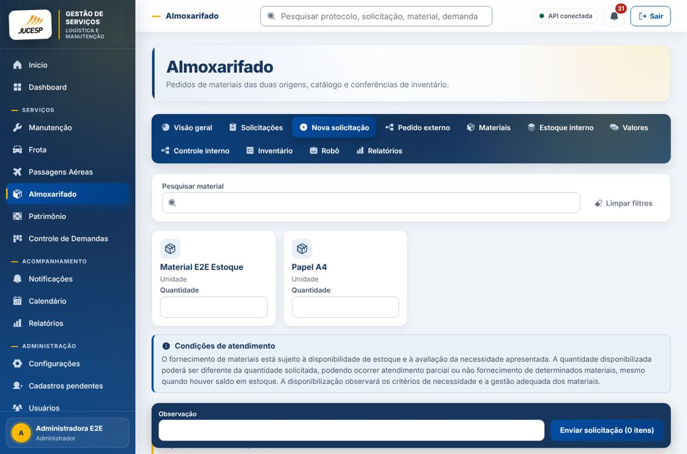

1. Clique em **Almoxarifado** e depois na aba **Nova solicitação**.
2. Procure os materiais, informe as quantidades e confira o resumo.
3. Envie. Você acompanha o pedido até a entrega.

### Cancelar ou corrigir

- Enquanto o pedido não começa a ser atendido, quem abriu pode **cancelar**, no detalhe da solicitação.
- Se a equipe **devolver para correção**, o aviso diz o que corrigir. Corrija no próprio detalhe e reenvie.

### Pedidos do próprio setor

Se o administrador ligar a permissão **"Consultar as solicitações do próprio setor"**, você passa a ver também os pedidos de Manutenção, Frota e Almoxarifado abertos pelos colegas do seu setor. É só para consulta. Passagens aéreas ficam de fora.

---

## 4. Atender os pedidos (equipe SLM)

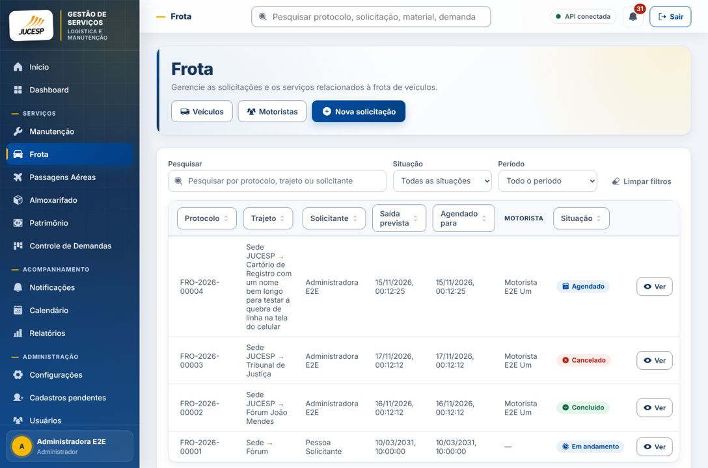

1. Abra o módulo (Manutenção, Frota ou Passagens). A lista mostra os pedidos de todos os setores.
2. Use os filtros (situação, período e pesquisa) e clique nas colunas para ordenar.
3. Clique em **Ver** para atender. No detalhe, conforme o módulo e a situação, você pode:
   - **agendar**: data, horário e responsável;
   - **registrar a execução** (Manutenção): quem fez, o que foi feito e as pendências;
   - **atribuir motorista e veículo** (Frota);
   - **registrar cotações e anexar o bilhete** (Passagens);
   - **devolver para correção**, dizendo o motivo;
   - **enviar e-mail** pela central de comunicação;
   - **anexar documentos** em **Documentos e anexos**.

Cada ação fica registrada na **linha do tempo**, com data, hora e responsável.

### Veículos, motoristas e equipamentos

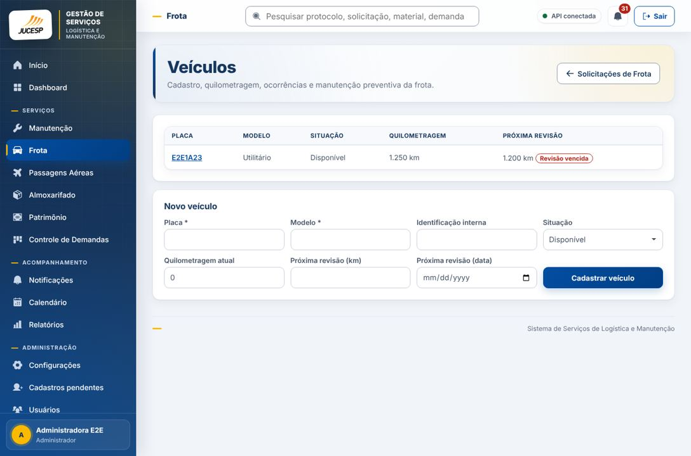

- **Frota → Veículos:** cadastro dos veículos e do diário de uso.
- **Frota → Motoristas:** cadastro dos motoristas e da conta de acesso de cada um ao Portal do Motorista.
- **Manutenção → Equipamentos:** cadastro dos equipamentos e do histórico de serviços de cada um.

### Calendário e relatórios

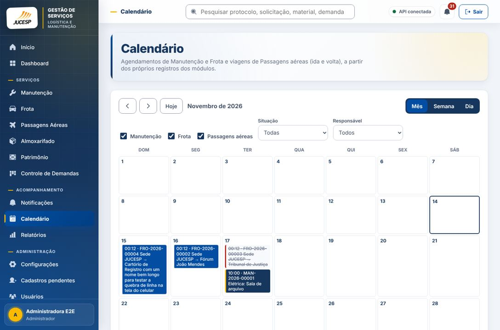

- **Calendário:** os agendamentos de todos os módulos, por mês, semana ou dia.
- **Relatórios:** números por período, setor e módulo, com exportação em PDF e Excel.

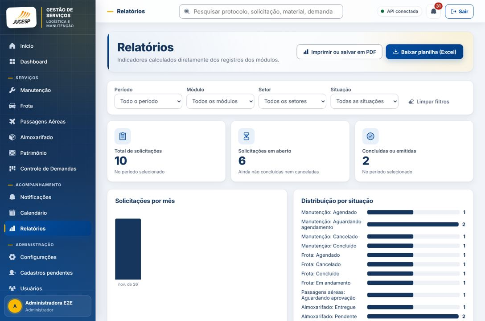

---

## 5. Almoxarifado

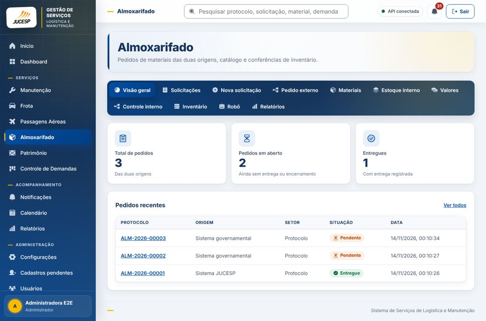

As abas do Almoxarifado:

- **Solicitações:** pedidos internos. Para atender, abra o pedido, informe o que foi entregue, mude a situação e registre a entrega. A entrega dá **baixa automática no estoque**.
- **Pedido externo:** registro de pedidos que chegaram pelo sistema governamental.
- **Materiais:** catálogo, com categoria, unidade e localização no armário.
- **Estoque interno:** saldo de cada material. Em **Registrar movimentação** você lança entradas e saídas. Numa entrada, escolha a **ata e o item**: o saldo da ata baixa sozinho. Se a ata for controlada em reais, informe o valor pago.
- **Inventário:** conferência física, na ordem dos armários.
- **Robô:** lê a planilha do governo para o inventário, sugere reposição e monta o resumo semanal.
- **Valores:** valor do estoque, compras e consumo por mês, e as atas e contratos.

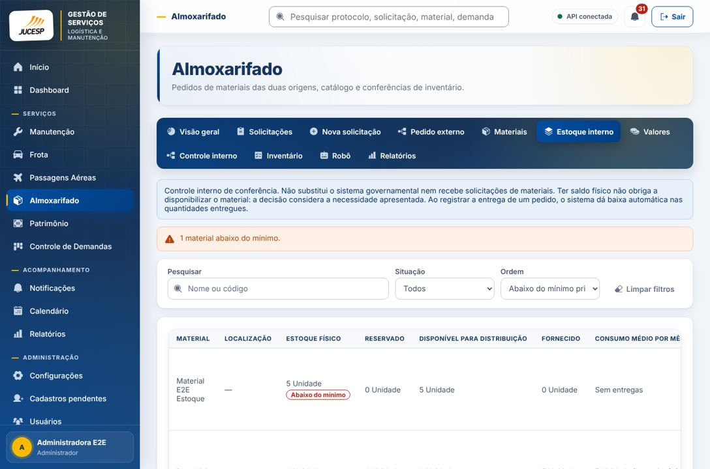

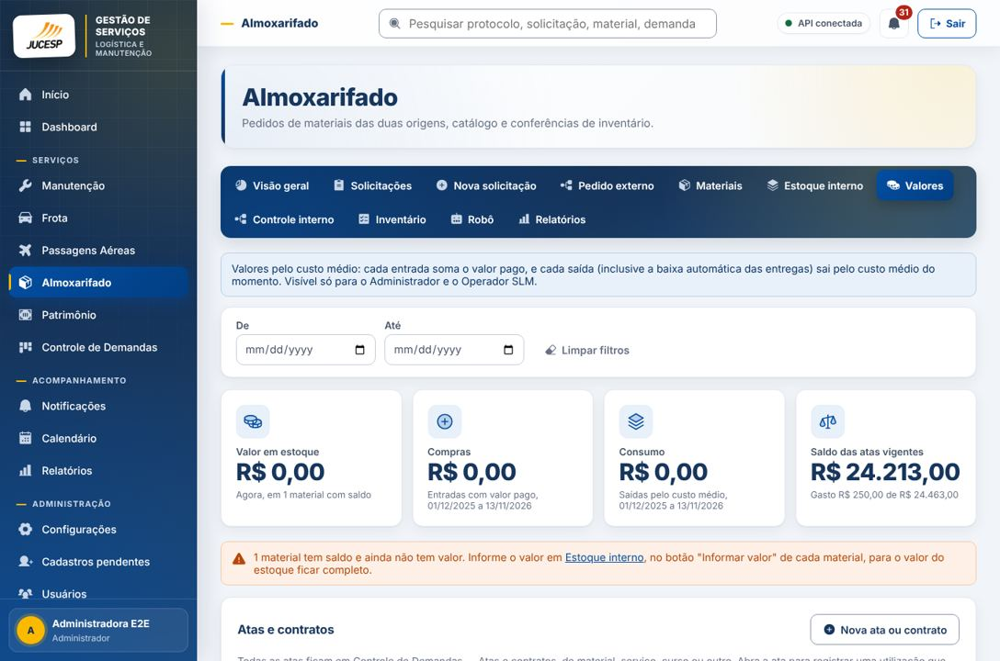

Em **Valores**, a seção **Atas e contratos** lista as atas vigentes. Clique em **Abrir e registrar utilização** para ir à ata.

---

## 6. Controle de Demandas, atas e contratos

O **Controle de Demandas** organiza as atividades administrativas dos setores. Cada pessoa vê o que o seu setor permite.

### Atas e contratos

Todas as atas ficam em **Controle de Demandas → Atas e Contratos**: de material, serviço, curso ou outro.

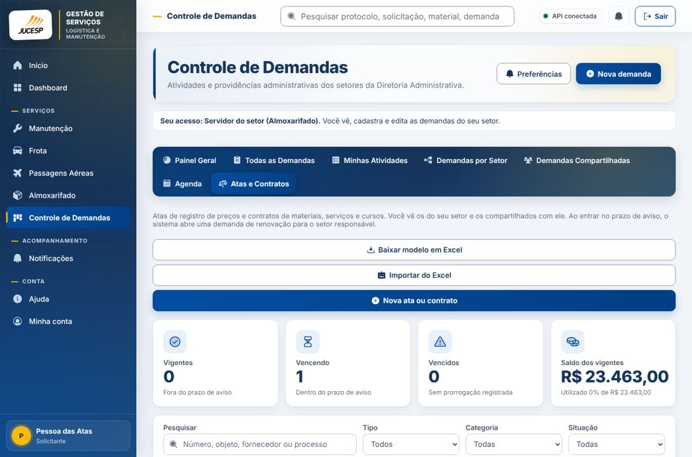

**Cadastrar uma ata pelo Excel (robô de atas)**
1. Em **Atas e Contratos**, clique em **Baixar modelo em Excel**.
2. Preencha no alto os dados da ata: tipo, número, objeto, categoria, fornecedor, processo, vigência e setor responsável.
3. Preencha embaixo a tabela de itens: item, descrição, unidade, quantidade e valor unitário. Se deixar o **valor total** em branco, o sistema soma os itens.
4. Salve a planilha e clique em **Importar do Excel**.
5. O formulário de **Nova ata** abre preenchido, com a lista de itens embaixo. Os avisos amarelos apontam o que precisa ser conferido, como uma linha sem unidade ou um total que não bate com a soma dos itens.
6. Confira e clique em **Salvar**. A ata e os itens são gravados juntos.

O robô também lê planilhas que só têm a tabela de itens, como um **quadro comparativo**. Ele entende títulos como "Especificação", "Qtd." e "Preço unitário", números como 1.234,56 e datas como 31/12/2026.

**Acrescentar itens a uma ata que já existe**
1. Abra a ata e, na seção **Itens**, clique em **Importar itens do Excel**.
2. Confira os itens lidos e clique em **Cadastrar N itens**.

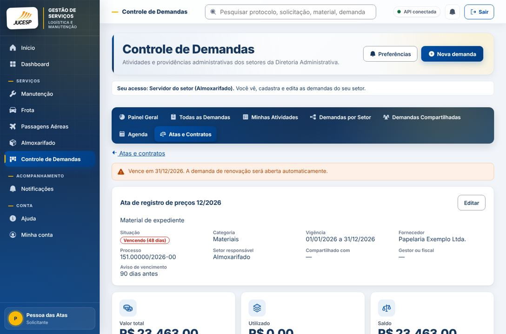

**Registrar uma utilização (empenho, pedido, ordem de serviço)**
1. Abra a ata e clique em **Registrar utilização**, no topo da seção **Utilizações**.
2. Escolha o item, a quantidade (ou o valor, se a ata for controlada em reais), a data e o documento.
3. Clique em **Registrar**. O saldo é atualizado na hora. A utilização não pode ser apagada.

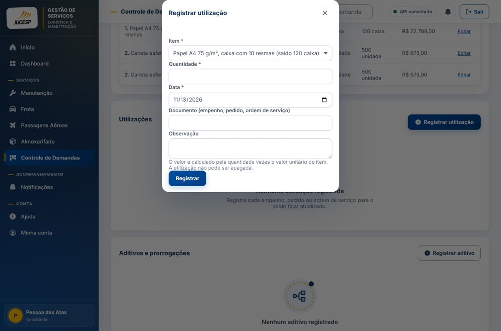

**Ata controlada só pelo valor** (um serviço, por exemplo): cadastre um item **"Valor global da ata"** com unidade **R$**, quantidade igual ao valor da ata e valor unitário 1,00. Cada utilização é então o valor gasto.

**Quem pode:** registrar e editar é para os integrantes do setor responsável pela ata e para os Diretores. O Administrador que não é Diretor só consulta.

**Vencimento:** dentro do prazo de aviso, o sistema abre sozinho uma **demanda de renovação** para o setor responsável. Prorrogações e mudanças de valor são registradas como **aditivos**.

---

## 7. Portal do Motorista

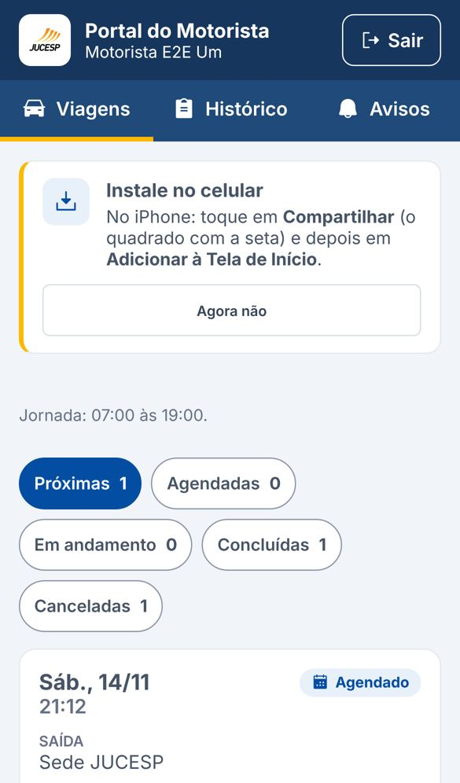

O motorista entra com o próprio e-mail e senha e vai direto para o portal, pensado para o celular.

1. **Viagens:** as próximas viagens, com saída, destino, passageiros e horário.
2. Ao sair, toque em **Iniciar viagem** e informe o que for pedido, como o hodômetro.
3. Durante a viagem, registre as **ocorrências** (atraso, problema no veículo), com foto se precisar.
4. Ao chegar, toque em **Finalizar viagem**.
5. **Histórico:** as viagens anteriores. **Avisos:** os comunicados da Frota.

Para instalar o portal no celular, veja a seção 1.

---

## 8. Administração

### Cadastros pendentes e usuários

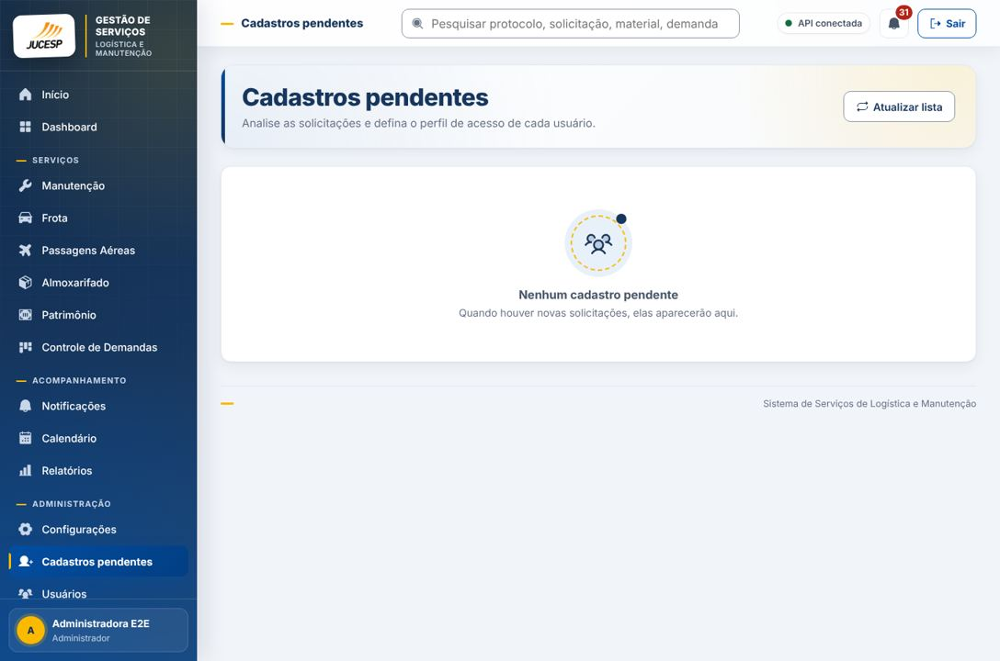

1. Em **Cadastros pendentes**, confira os dados e clique em **Aprovar**, escolhendo o perfil, ou em **Rejeitar**.
2. Em **Usuários**, clique numa pessoa para ver o cadastro, que está dividido em abas:
   - **Dados e situação:** nome, setor e ativar ou desativar a conta;
   - **Vínculos:** os setores e diretorias da pessoa no Controle de Demandas;
   - **Perfil e permissões:** o perfil (Solicitante, Operador SLM, Administrador ou Motorista), a equipe SLM e as permissões individuais;
   - **Histórico:** todas as alterações, com data e autor.

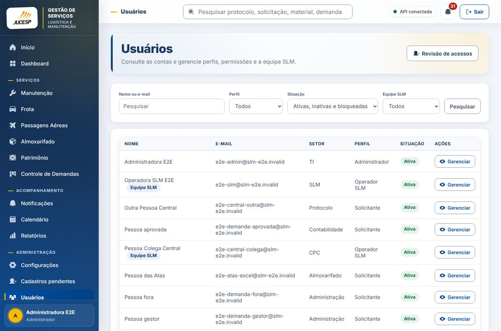

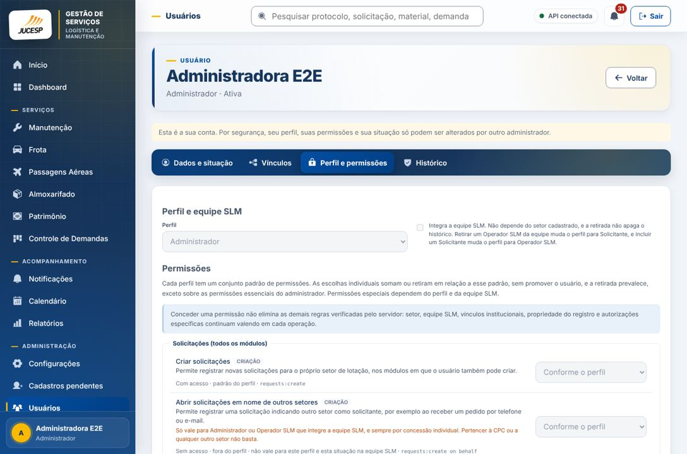

### Configurações

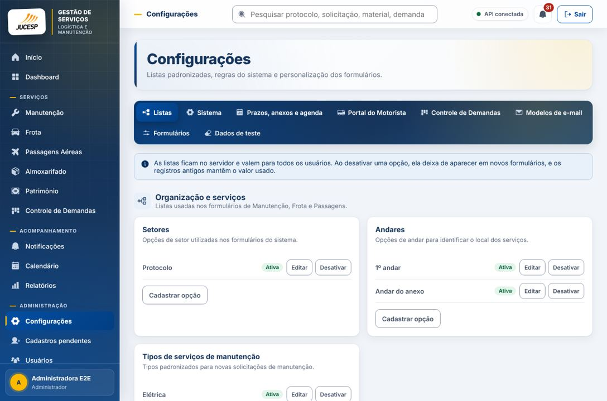

As Configurações estão divididas em abas:

| Aba | O que tem |
|---|---|
| **Listas** | Setores, andares, tipos de serviço, categorias e unidades |
| **Sistema** | Domínios de e-mail aceitos, feriados, aviso geral no topo, módulos ligados e as **permissões padrão** de cada perfil |
| **Prazos, anexos e agenda** | Prazos e alertas, notificações por perfil, limites dos anexos e horários |
| **Portal do Motorista** | Jornada, execução das viagens e notificações |
| **Controle de Demandas** | Setores, integrantes e categorias |
| **Modelos de e-mail** | Os textos das mensagens enviadas |
| **Formulários** | O Gerenciador de formulários |
| **Dados de teste** | Limpeza dos dados de teste (só o Administrador) |

**Para ligar "Consultar as solicitações do próprio setor" para todos os solicitantes:** vá em **Sistema → permissões padrão**, perfil Solicitante, acrescente a permissão e salve.

### Gerenciador de formulários

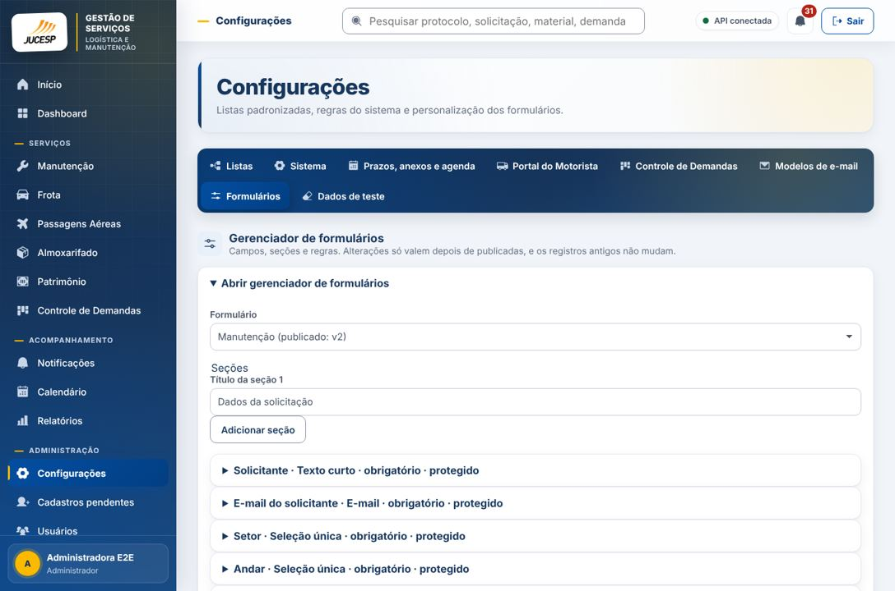

1. Em **Configurações → Formulários**, clique em **Abrir gerenciador de formulários** e escolha o formulário.
2. Renomeie, reordene ou torne obrigatórios os campos. Para criar um campo, clique em **Adicionar campo** e escolha o tipo.
3. O tipo **Anexo (arquivo)** está disponível em Manutenção, Frota, Passagens, pedido de materiais e pedido externo. O arquivo vai para **Documentos e anexos** da solicitação.
4. Clique em **Salvar rascunho** para guardar sem publicar, ou em **Publicar** para valer nos próximos pedidos. Os pedidos antigos não mudam.

### Monitoramento e auditoria

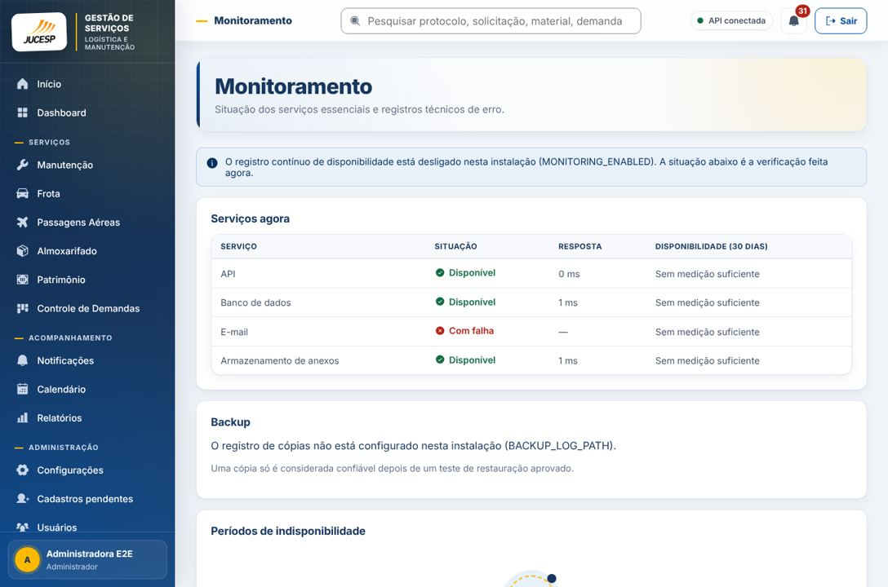

- **Monitoramento:** a situação da API, do banco, do e-mail e do armazenamento de anexos, e os incidentes recentes.
- **Auditoria:** quem fez o quê e quando. Os registros são permanentes.

---

## 9. Dúvidas frequentes

**Não recebi o código para recuperar a senha.**
Confira a caixa de spam. Se não chegar, peça à equipe SLM.

**O sistema demorou para abrir.**
No plano gratuito, a API "dorme" quando ninguém usa. A primeira pessoa espera cerca de 1 minuto, e depois o sistema fica rápido.

**Não vejo um módulo no menu.**
O menu mostra só o que o seu perfil permite. Peça ao administrador.

**Não consigo registrar a utilização de uma ata.**
Você precisa ser do setor responsável pela ata, ou Diretor. Peça para ser incluído no setor, em **Configurações → Controle de Demandas**.

**Onde ficam os arquivos anexados?**
No armazenamento privado do sistema. Eles só podem ser baixados por quem tem acesso à solicitação, e o conteúdo é conferido antes de cada download.

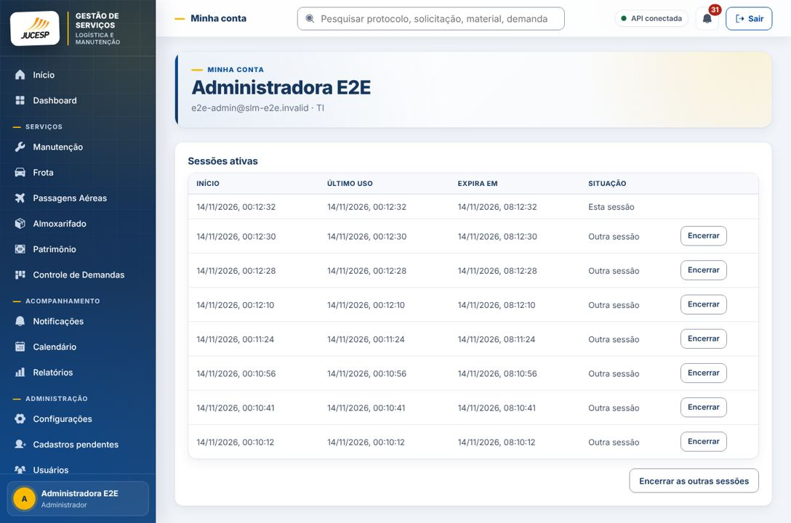

Em **Minha conta** você troca a senha e escolhe como quer receber os avisos.
